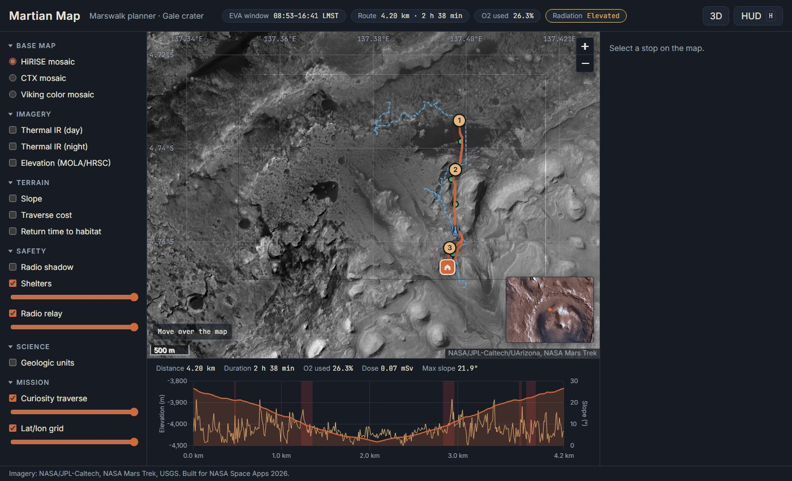
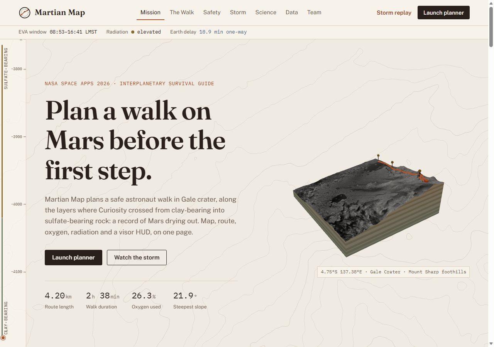
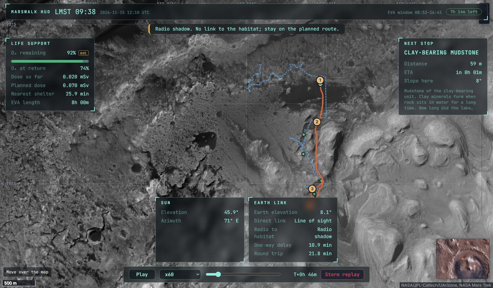

# Martian Map: Marswalk Planner

**NASA Space Apps Challenge 2026 · Interplanetary Survival Guide: Martian Map**

**Live site:** https://serdarakbay.github.io/marswalk-planner/  
**Planner:** https://serdarakbay.github.io/marswalk-planner/planner.html · **Storm replay:** https://serdarakbay.github.io/marswalk-planner/planner.html?radiation=replay



Martian Map plans a safe astronaut walk (a "Marswalk") in Gale crater, where Curiosity crossed from the clay-bearing unit into the sulfate-bearing unit of Mount Sharp between 2019 and 2023. The walk follows that clay-to-sulfate transition, a record of the climate drying out. It brings together everything a crew needs on one page:

- **Layered map:** high-resolution orbital imagery (HiRISE, CTX, Viking), day and night thermal infrared, elevation shading, slope, traverse cost, return-time rings, geologic units, shelters, radio shadow and a radio relay. Click anywhere for the elevation and slope there.
- **Safe route:** a least-cost walk from the habitat through the science stops and back, limited by slope, with oxygen use and radiation dose for the whole walk.
- **Elevation profile:** elevation and slope along the route, with radio-shadow stretches where the crew loses contact. Hovering the profile marks the same spot on the map.
- **Radio relay:** a mast on the ridge that cuts the time without a link to the habitat; the map and the landing page show the time before and after.
- **Stop cards:** what to look at at each stop, with nearby Curiosity photos and the arrival time on the route.
- **3D view:** the HiRISE image draped over the real terrain, with the route, stops, habitat, Sun shadows and the HUD astronaut. **Fly along your route** draws the walk from A to B; **Bodycam** starts the HUD walk and follows the astronaut at ground level, with the next stop's distance and climb on its label. Press the **3D** button.
- **HUD mode:** a visor view with the next stop, O2, dose, Sun and Earth position, outside air temperature and alerts, a simulation clock, and two replayable emergencies: a solar storm (shelters ranked by dose, a path around steep ground to the chosen one) and dust devils (hold position or step aside). Near a stop it shows Curiosity's photo of that spot, and the Targets panel answers "can I go there?" for ten more places Curiosity photographed off the route ([details](web/js/hud/README.md)). Press **H**.
- **Data sources:** a small panel (the *Data sources* link in the footer) lists every dataset, what the planner uses it for and its status, read from the loaded data (for example Live or Replay for the solar events).
- **Backup map tiles:** if Mars Trek cannot be reached, the map, the minimap and the landing 3D block fall back to cached tiles of the study area in `web/tiles/`.
- **Landing page:** the site root introduces the walk, the safety layers, the storm and the models, with a 3D block diagram of the study area; every number on it is read from the data files. The planner itself is `planner.html`.

| Landing page | HUD |
|---|---|
|  |  |

## Study area

- About 2.4 × 2.4 km in Gale crater: west 137.36°E, east 137.40°E, south 4.77°S, north 4.73°S (east-positive longitude, planetocentric latitude).
- The habitat location and the bounding box are read from `web/data/area.json`; no coordinate is hard-coded.

## How it works

The site is static (plain HTML and ES modules, no build step) and is published from `web/` by GitHub Pages. Python scripts fetch and process the data ahead of time and write JSON files to `web/data/`; the browser only reads those files. The only things loaded live are the Mars Trek map tiles and the Curiosity photos.

```
pipeline/       data fetchers (Mars Trek, backup tiles, Curiosity, REMS, JPL Horizons, DONKI, USGS)
arazi/          terrain: DEM clip, slope, cost map, least-cost route, return-time rings, heightmap
science/        O2 and dose models, radiation, alerts, safety (radio shadow, relay, shelters), EVA window
config/         mission.json: every threshold and constant in one place
web/
  index.html    landing page (js/landing/, css/landing.css)
  planner.html  the planner: map (js/map/), HUD (js/hud/), stop cards (js/cards/), 3D view (js/view3d/)
  data/         generated JSON and PNG layers
  tiles/        cached Mars Trek tiles for the study area
docs/           data contracts (contracts.md), model assumptions (story/assumptions.md), UI credits (credits.md)
```

Every model number (walking speed, metabolic rate, O2, dose, thresholds) is listed with its source in [docs/story/assumptions.md](docs/story/assumptions.md).

## Data status

| Data | Status |
|---|---|
| Base maps and thermal/elevation layers (Mars Trek) | Real |
| Curiosity traverse, raw images, REMS temperature | Real |
| Sun and Earth position (JPL Horizons, Mars24), EVA window | Real |
| DEM slope, cost map, route, return-time rings, route summary | Real, computed from the DEM |
| Science stops (clay-to-sulfate story) | Real, chosen from Curiosity's visits |
| Shelters and radio shadow | Real, computed from the DEM |
| HUD alert rules | Real, from `config/mission.json` |
| Solar events and radiation status | Real (live NASA DONKI); the 20 May 2024 storm is a replay of Curiosity RAD data |
| Geologic units (USGS SIM 3292, clipped to Gale crater) | Real |
| Habitat location | Provisional |

## Run locally

```bash
python -m http.server 8000 -d web      # landing: http://localhost:8000 · planner: http://localhost:8000/planner.html
```

Opening the pages directly from disk does not work: ES modules and `fetch('data/...')` need a local server.

The landing page reads the mission constants from `web/data/mission.json`, which GitHub Pages copies from `config/mission.json` at deploy time. For a local preview, copy it once (the copy is git-ignored):

```bash
cp config/mission.json web/data/mission.json
```

To rebuild the data (Python 3.11):

```bash
python -m venv .venv
# Windows: .venv\Scripts\activate    macOS/Linux: source .venv/bin/activate
pip install -r requirements.txt
cp .env.example .env                    # add NASA_API_KEY
python -m pipeline.fetch.trek           # map layers -> web/data/layers.json
```

The full list of commands, by owner, is in [CLAUDE.md](CLAUDE.md).

## Team

| | Role |
|---|---|
| Ege | Map, integration, site |
| Demir | Terrain and route |
| Egemen | Curiosity and REMS data, stop cards, UI and 3D design |
| Serdar | Horizons, EVA window, HUD, geologic map, science targets (with Utku), data sources panel |
| Utku | Science models, safety layers, radiation, story |

## Who built what

Taken from the commit history. Where two names are given, the work was shared: the second person supplied the data or model it builds on, or owns the file it was added to and agreed the change.

### Ege

| Work | By |
|---|---|
| Team plan, `CLAUDE.md` rules (ownership, git, data contracts, page layout), GitHub Pages deploy | Ege |
| Page skeleton: `main.js` state loader, `base.css` palette, module boxes | Ege |
| Leaflet map with Mars Trek base layers, grouped layer panel, stop and habitat badges, header status chips | Ege, Utku (`layers.json`) |
| Elevation profile: elevation, slope, route stats, radio-shadow bands, hover-to-map | Ege, Demir (`summary.json`), Utku (`safety.json`) |
| Astronaut marker and profile line from `hud:time` | Ege, Serdar (HUD position) |
| Storm replay on the map (nearest shelter ring and line, fly-to), geology and shelter layers | Ege, Utku, Serdar |
| Radio relay on the map and the landing page | Ege, Utku (relay) |
| Landing page: data-driven sections, 3D block diagram, contours, poster, HUD screenshot | Ege |
| Backup tiles for the landing 3D block and the minimap | Ege, Utku (tile cache) |
| README, screenshots, integration and merges into `main` | Ege |

### Demir

| Work | By |
|---|---|
| DEM check, clip and slope (USGS 1 m Gale DEM) | Demir |
| Cost map, slope and cost overlays, `to_overlay_png()` shared with Utku | Demir |
| Least-cost route and `summary.json` through the real clay-to-sulfate stops | Demir, Utku (stops, O2 model) |
| Return-time rings (15 min), shared walking model | Demir, Utku (O2 model) |
| Heightmap (`summary.terrain`) used by the 3D view, the landing block and the HUD paths | Demir |
| Shaded relief and roughness layers, comparison with Curiosity's traverse | Demir, Egemen (traverse) |

### Egemen

| Work | By |
|---|---|
| Curiosity raw images and traverse, REMS temperature (`images.json`, `traverse.geojson`, `weather.json`) | Egemen |
| Stop cards: nearby Curiosity photos, arrival and departure times, mission briefing, guided stop tour | Egemen, Utku (stops) |
| Regolith palette for the cards and the 3D view | Egemen |
| 3D view: HiRISE-draped real terrain at true scale, route, stops, habitat, Sun shadows, fly-through, HUD astronaut | Egemen, Demir (heightmap), Serdar (`hud:time`) |
| UI credits (`docs/credits.md`) | Egemen |

### Serdar

| Work | By |
|---|---|
| Sun and Earth position from JPL Horizons, local Mars time with the Mars24 algorithm (`sun.json`) | Serdar |
| EVA window from the Sun elevation and Curiosity's REMS temperature (`eva_window.json`) | Serdar, Egemen (REMS data) |
| Real geologic units from the USGS map SIM 3292, clipped to Gale crater (`geology.geojson`) | Serdar (taken over from Utku) |
| HUD: visor view, next stop and arrival time, O2, dose, Sun and Earth panels, simulation clock (play, speed, time slider, smooth position), H key | Serdar |
| HUD alerts: `alerts.json` rules plus built-in ones (Earth below the horizon, outside the EVA window), radio-shadow countdown, point of no return | Serdar, Utku (alert rules, radio shadow in `safety.json`) |
| Mission log, arrival preview (Curiosity's Navcam view of the next stop), Stop at stops | Serdar, Egemen (Curiosity photos, stop cards) |
| Solar storm replay (20 May 2024): shelters ranked by dose, best one recommended, crew can pick another, back to the habitat when O2 runs short | Serdar, Utku (replay storm block, shelters, O2 and dose models) |
| Paths around steep ground (Dijkstra on the heightmap, nothing steeper than 25°), slope off the route | Serdar, Demir (heightmap) |
| Two dust devils: hold position, then step aside off the track and rejoin the route | Serdar |
| Science targets off the route: `science/targets.py` and `targets.json` | Serdar, Utku (candidates and unit rules) |
| Targets panel: "can I go there?" (O2 reserve, EVA window), path preview, detour with sampling | Serdar |
| HUD self-tests (`node web/js/hud/test.mjs`, 43 checks on logic and real data) | Serdar |
| Data sources panel with live status (`web/js/map/sources.js`, footer link) | Serdar, Ege (map) |
| Map: storm path line, moving dust devil circle, zoom that includes the hazard, click for elevation and slope, cursor coordinates, lat/lon grid, overview minimap | Serdar, Ege (map owner) |
| Header keeps the 3D and HUD buttons on screen at laptop widths | Serdar, Ege (`base.css`) |
| 3D view: Bodycam that follows the HUD astronaut (starts the HUD walk, labels the next stop with distance and climb), path line that follows the HUD path | Serdar, Egemen (3D view owner) |
| HUD documentation: `web/js/hud/README.md`, HUD parts of this README and `CLAUDE.md` | Serdar, Ege |

### Utku

| Work | By |
|---|---|
| `area.json` (study area, habitat), data contracts (`docs/contracts.md`), mock data and its checker | Utku |
| `mission.json` (every threshold and constant), O2 and dose models, assumptions (`docs/story/assumptions.md`) | Utku |
| Mars Trek layers (`layers.json`) and the backup tile cache | Utku |
| Solar events from DONKI and `radiation.json` with the 20 May 2024 replay storm (habitat dose factor, storm duration) | Utku |
| Real science stops for the clay-to-sulfate story (`stops.json`) | Utku |
| Radio shadow, shelters along the route, radio relay (`safety.json`) | Utku, Demir (DEM clip, `to_overlay_png()`) |
| HUD alert rules (`alerts.json`) | Utku |
| Science target candidates and unit rules for `targets.json` | Utku, Serdar |

## Credits

**Imagery and data**

- HiRISE: NASA/JPL-Caltech/University of Arizona
- CTX: NASA/JPL-Caltech/MSSS
- Viking color mosaic: NASA/JPL/USGS
- THEMIS day and night IR: NASA/JPL-Caltech/Arizona State University
- MOLA and HRSC color hillshade: NASA/JPL/GSFC, ESA/DLR/FU Berlin
- All map tiles served by [NASA Mars Trek](https://trek.nasa.gov/mars/)
- Gale crater DEM (MSL Gale DEM Mosaic, 1 m): USGS Astrogeology
- Curiosity raw images: NASA/JPL-Caltech (Mastcam, MAHLI and MARDI: NASA/JPL-Caltech/MSSS)
- Curiosity traverse: NASA/JPL-Caltech (MMGIS)
- REMS temperature: Centro de Astrobiología (CSIC-INTA) / NASA/JPL-Caltech
- Sun and Earth position: [JPL Horizons](https://ssd.jpl.nasa.gov/horizons/); local time: Mars24 algorithm (Allison & McEwen, 2000)
- Solar events: [NASA DONKI](https://kauai.ccmc.gsfc.nasa.gov/DONKI/)
- Geologic units: Tanaka, K.L., et al., 2014, Geologic Map of Mars, USGS Scientific Investigations Map 3292 (public domain), [doi:10.3133/sim3292](https://doi.org/10.3133/sim3292)

**Software**

- [Leaflet](https://leafletjs.com/) (BSD-2-Clause)
- [Chart.js](https://www.chartjs.org/) (MIT)
- [three.js](https://threejs.org/) (MIT): 3D view and the landing block diagram
- [d3-contour](https://github.com/d3/d3-contour) (ISC): contour lines on the landing page
- Fonts: Fraunces, Public Sans and IBM Plex Mono (SIL Open Font License, via Google Fonts)

Libraries used in the stop cards and the 3D view are listed with their versions in [docs/credits.md](docs/credits.md).
