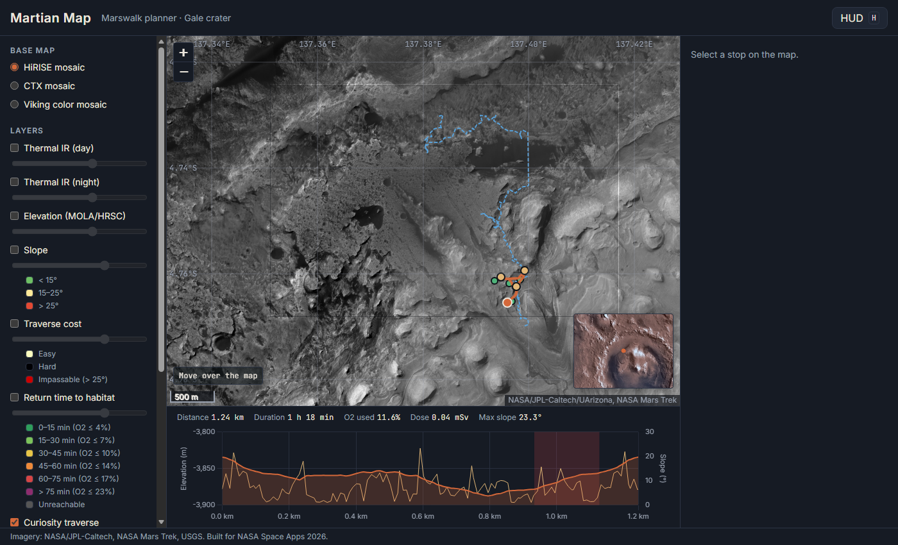

# Martian Map: Marswalk Planner

**NASA Space Apps Challenge 2026 · Interplanetary Survival Guide: Martian Map**

**Live site:** https://serdarakbay.github.io/marswalk-planner/



Martian Map plans a safe astronaut walk (a "Marswalk") in Gale crater, where Curiosity crossed from the clay-bearing unit into the sulfate-bearing unit of Mount Sharp between 2019 and 2023. The walk follows that clay-to-sulfate transition, a record of the climate drying out. It brings together everything a crew needs on one page:

- **Layered map:** high-resolution orbital imagery (HiRISE, CTX, Viking), day and night thermal infrared, elevation shading, slope, traverse cost, return-time rings, geologic units and shelters.
- **Safe route:** a least-cost walk from the habitat through the science stops and back, limited by slope, with oxygen use and radiation dose for the whole walk.
- **Elevation profile:** elevation and slope along the route, with radio-shadow stretches where the crew loses contact. Hovering the profile marks the same spot on the map.
- **Stop cards:** what to look at at each stop, with nearby Curiosity photos and the arrival time on the route.
- **HUD mode:** a visor view with the next stop, remaining O2, dose, Sun and Earth position, and alerts. A simulation clock moves the astronaut along the route on the map and the profile. Press **H** or the HUD button.

## Study area

- About 2.4 × 2.4 km in Gale crater: west 137.36°E, east 137.40°E, south 4.77°S, north 4.73°S (east-positive longitude, planetocentric latitude).
- The habitat location and the bounding box are read from `web/data/area.json`; no coordinate is hard-coded.

## How it works

The site is static (plain HTML and ES modules, no build step) and is published from `web/` by GitHub Pages. Python scripts fetch and process the data ahead of time and write JSON files to `web/data/`; the browser only reads those files. The only things loaded live are the Mars Trek map tiles and the Curiosity photos.

```
pipeline/   data fetchers (Mars Trek, Curiosity, REMS, JPL Horizons, ...)
arazi/      terrain: DEM clip, slope, cost map, least-cost route, return-time rings
science/    O2 and dose models, EVA window, mock data generator
config/     mission.json: every threshold and constant in one place
web/        the site: map, HUD, stop cards, data files
docs/       data contracts (contracts.md) and the model assumptions (story/assumptions.md)
```

Every model number (walking speed, metabolic rate, O2, dose, thresholds) is listed with its source in [docs/story/assumptions.md](docs/story/assumptions.md).

## Data status

Some files are still provisional while the team finishes the pipeline. Files marked "mock" have the final schema but placeholder values; they are replaced under the same name when the real data is ready.

| Data | Status |
|---|---|
| Base maps and thermal/elevation layers (Mars Trek) | Real |
| Curiosity traverse, raw images, REMS temperature | Real |
| Sun and Earth position (JPL Horizons, Mars24), EVA window | Real |
| DEM slope, cost map, route, return-time rings, route summary | Real, computed from the DEM |
| Habitat location | Provisional |
| Stops, shelters and radio shadow, alerts, radiation status, solar events, geologic units | Mock |

## Run locally

```bash
python -m http.server 8000 -d web      # open http://localhost:8000
```

Opening `web/index.html` directly from disk does not work: ES modules and `fetch('data/...')` need a local server.

To rebuild the data (Python 3.11):

```bash
python -m venv .venv
# Windows: .venv\Scripts\activate    macOS/Linux: source .venv/bin/activate
pip install -r requirements.txt
cp .env.example .env                    # add NASA_API_KEY
python -m pipeline.fetch.trek           # map layers -> web/data/layers.json
```

The full list of commands, by owner, is in [CLAUDE.md](CLAUDE.md).

## Team

| | Role |
|---|---|
| Ege | Map, integration, site |
| Demir | Terrain and route |
| Egemen | Curiosity and REMS data, stop cards, UI and 3D design |
| Serdar | Horizons, EVA window, HUD, geologic map |
| Utku | Science models, safety layers, radiation, story |

## Credits

**Imagery and data**

- HiRISE: NASA/JPL-Caltech/University of Arizona
- CTX: NASA/JPL-Caltech/MSSS
- Viking color mosaic: NASA/JPL/USGS
- THEMIS day and night IR: NASA/JPL-Caltech/Arizona State University
- MOLA and HRSC color hillshade: NASA/JPL/GSFC, ESA/DLR/FU Berlin
- All map tiles served by [NASA Mars Trek](https://trek.nasa.gov/mars/)
- Gale crater DEM (MSL Gale DEM Mosaic, 1 m): USGS Astrogeology
- Curiosity raw images: NASA/JPL-Caltech (Mastcam, MAHLI and MARDI: NASA/JPL-Caltech/MSSS)
- Curiosity traverse: NASA/JPL-Caltech (MMGIS)
- REMS temperature: Centro de Astrobiología (CSIC-INTA) / NASA/JPL-Caltech
- Sun and Earth position: [JPL Horizons](https://ssd.jpl.nasa.gov/horizons/); local time: Mars24 algorithm (Allison & McEwen, 2000)
- Solar events: [NASA DONKI](https://kauai.ccmc.gsfc.nasa.gov/DONKI/)

**Software**

- [Leaflet](https://leafletjs.com/) (BSD-2-Clause)
- [Chart.js](https://www.chartjs.org/) (MIT)
